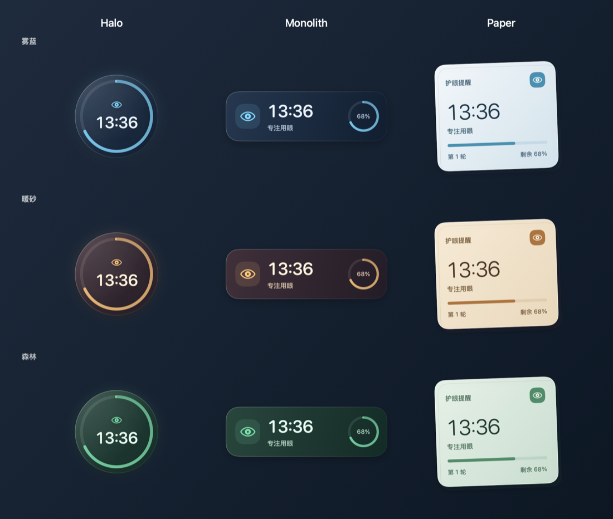

# EyeTimer · 护眼提醒

**让休息成为日常，让提醒融入桌面。**

EyeTimer 是一款轻巧的 macOS 护眼计时工具。它按照 20-20-20 节奏提醒你：每专注 20 分钟，看向约 6 米外的远处，休息至少 20 秒。

[下载最新版本](https://github.com/pinguo-lixin/eye-timer/releases/latest) · [安装帮助](docs/install.md) · [反馈问题](https://github.com/pinguo-lixin/eye-timer/issues)

## 把提醒放在你喜欢的位置

桌面挂件可以自由拖动，随时查看距离下一次休息还有多久。你可以让它融入桌面，也可以始终置顶，或隐藏挂件，只保留菜单栏倒计时。

| 样式 | 感受 |
| --- | --- |
| **Halo** | 简洁的圆形光环，用倒计时和图标传达状态 |
| **Monolith** | 紧凑的横向面板，时间与剩余进度一目了然 |
| **Paper** | 轻盈的纸张质感，适合喜欢柔和桌面的你 |

每种样式都支持 **雾蓝、暖砂、森林** 三种主题。大小、辅助文字与透明度均可调整；开启悬停提亮后，鼠标移到挂件上即可看清内容。

## 按自己的节奏休息

- 自定义专注、短休息和长休息的时长。
- 用全屏休息引导、系统通知、提示音或语音提醒自己。
- 休息时显示倒计时和远眺提示，也可以随时跳过。
- 在挂件上按右键，即可开始、暂停、切换样式、主题和透明度。
- 通过菜单栏快速继续、重新开始或停止计时。

## 看见自己的用眼习惯

查看今日专注周期、休息次数与累计专注时长，以及最近七天的记录。无需注册账户，设置和统计数据保存在本机。

## 下载与开始使用

支持 **macOS 13 及以上版本**。

1. 前往 [下载页面](https://github.com/pinguo-lixin/eye-timer/releases/latest)，选择适合自己 Mac 的版本。
2. 打开 DMG，将 **EyeTimer.app** 拖入 **Applications（应用程序）**。
3. 从「应用程序」打开 EyeTimer，点击菜单栏的眼睛图标，选择「开始」。

| 你的 Mac | 选择的下载文件 |
| --- | --- |
| Apple Silicon（M 系列芯片） | 文件名包含 `arm64` 的 DMG |
| Intel 处理器 | 文件名包含 `x86_64` 的 DMG |

不确定机型时，可点击苹果菜单 →「关于本机」查看。下载页面也提供 ZIP，解压后同样将应用拖入「应用程序」。

首次打开被系统阻止、通知未显示或需要设置权限时，请查看 [安装帮助](docs/install.md)。

## 常用操作

| 想做什么 | 操作 |
| --- | --- |
| 开始或暂停 | 挂件右键菜单，或菜单栏眼睛图标 |
| 更换外观 | 挂件右键 →「挂件样式」「配色主题」 |
| 调低透明度 | 挂件右键 →「透明度」；「精细调节…」可连续调整 |
| 隐藏辅助文字、调整大小 | 设置 →「桌面挂件」 |
| 改变提醒方式 | 设置 →「提醒方式」 |
| 查看统计 | 设置 →「使用统计」 |
| 开机自动启动 | 设置 →「关于」 |

欢迎通过 [GitHub Issues](https://github.com/pinguo-lixin/eye-timer/issues) 反馈问题或分享建议。
